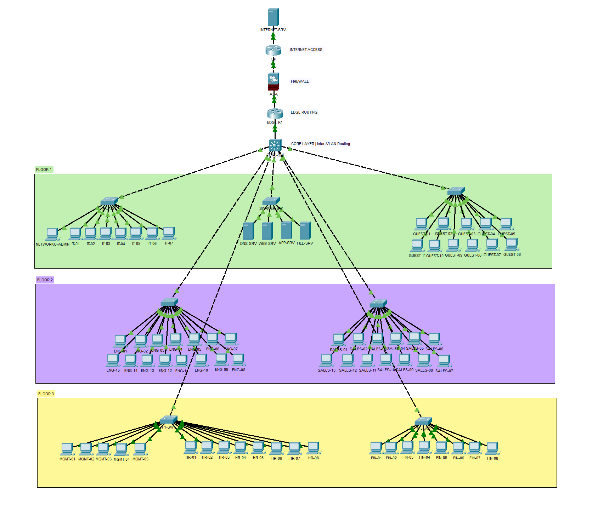

# NexaTech — Secure Enterprise Network

NexaTech is a fictional technology company represented by a multi-floor enterprise network simulation built in Cisco Packet Tracer. The project demonstrates departmental VLAN segmentation, inter-VLAN routing, internal network services, access-control policies, SSH-based device administration, and firewall-controlled connectivity to simulated external networks.

> **Project type:** Educational network simulation. The topology and external services are simulated; this is not a production deployment or a real public Internet service.

## Project at a glance

- Three-floor office topology with access switches and a multilayer core switch.
- VLANs for Engineering, Sales & Marketing, Guest, HR, Finance, IT, Management, Servers, and Network Management.
- Inter-VLAN routing through switched virtual interfaces (SVIs) on `CORE-SW`.
- DHCP for configured client VLANs, plus internal DNS, Web, Application, and File server roles.
- Department ACLs that restrict access to the server subnet according to defined service rules, plus a Guest access policy.
- SSH-based management access restricted to the designated network-administration host.
- ASA firewall with dynamic PAT for outbound connectivity and static NAT for the Web Server.
- Outside ACL permitting inbound HTTP and HTTPS to the published Web Server.

## Topology

High-level traffic path:

`Departmental PCs → Access switches → CORE-SW → EDGE-R1 → ASA → ISP → INTERNET-SRV`

Detailed views:

- [Floor 1](screenshots/floor1.png)
- [Floor 2](screenshots/floor2.png)
- [Floor 3](screenshots/floor3.png)
- [Core, edge, firewall, and ISP](screenshots/edge-security.png)

## Subnetting and VLSM design

The internal address plan uses the private block `10.10.0.0/16`, subdivided into smaller networks using **Variable Length Subnet Masking (VLSM)**. Different prefix lengths provide different address capacities: `/27` for the larger Engineering VLAN, `/28` for standard department, Guest, and Network Management VLANs, `/29` for Management and Servers, and `/30` for routed point-to-point infrastructure links.

| Prefix | Subnet mask | Total addresses | Usable host addresses | Use in this design |
|---|---|---:|---:|---|
| `/27` | `255.255.255.224` | 32 | 30 | Engineering, VLAN 40 |
| `/28` | `255.255.255.240` | 16 | 14 | HR, Finance, IT, Sales & Marketing, Guest, Network Management |
| `/29` | `255.255.255.248` | 8 | 6 | Management, VLAN 10; Servers, VLAN 70 |
| `/30` | `255.255.255.252` | 4 | 2 | CORE–EDGE and EDGE–ASA routed links |

| VLAN | Name | Subnet | Default gateway |
|---:|---|---|---|
| 10 | Management | `10.10.0.112/29` | `10.10.0.118` |
| 20 | HR | `10.10.0.64/28` | `10.10.0.78` |
| 30 | Finance | `10.10.0.80/28` | `10.10.0.94` |
| 40 | Engineering | `10.10.0.0/27` | `10.10.0.30` |
| 50 | Sales & Marketing | `10.10.0.32/28` | `10.10.0.46` |
| 60 | IT | `10.10.0.96/28` | `10.10.0.110` |
| 70 | Servers | `10.10.0.120/29` | `10.10.0.126` |
| 80 | Guest | `10.10.0.48/28` | `10.10.0.62` |
| 99 | Network Management | `10.10.0.128/28` | `10.10.0.142` |
| 999 | Native / Unused | No SVI subnet | — |

Usable-host capacities describe the subnet design, not actual employee counts. VLAN 999 is reserved as the native/unused VLAN and has no SVI subnet. See [Subnetting and VLSM](docs/subnetting-vlsm.md) for subnet masks, usable ranges, broadcast addresses, and allocation rationale.

## Servers and simulated external networks

| Component | Address | Purpose |
|---|---|---|
| DNS Server | `10.10.0.121` | Internal name resolution for the NexaTech website |
| Web Server | `10.10.0.122` | Internal website and published HTTP/HTTPS service |
| App Server | `10.10.0.123` | Application-server role in the simulation |
| File Server | `10.10.0.124` | File-server role; FTP is permitted where defined by department policy |
| Public Web address | `203.0.113.10` | Static NAT address for the Web Server |
| Simulated Internet Server | `198.51.100.10` | External HTTP endpoint used to validate outbound connectivity/PAT |

The internal website was tested using `http://www.nexatech.local` and directly using `http://10.10.0.122`. The published Web Server was tested from `INTERNET-SRV` using `http://203.0.113.10` and `https://203.0.113.10`.

The infrastructure uses `203.0.113.4/30` for the ASA-to-ISP transit link, `203.0.113.8/29` for the routed public NAT block, and `198.51.100.0/24` for the ISP-to-Internet-Server network. These are documentation/test ranges for the simulation, not real public services. See [Network Design](docs/network-design.md) for interface addressing and routing details.

## Security controls

- **Department/server ACLs:** Permit selected services to specified servers, including DNS, HTTP/HTTPS, application HTTPS, and file-service FTP where defined by the relevant policy. Other traffic to the Server VLAN is denied by the department policy rules. A final `permit ip any any`, where present, allows traffic not matched by earlier rules, so these ACLs do not provide complete isolation between departmental VLANs.
- **Guest policy:** Permits HTTP/HTTPS to the Web Server and denies traffic to the listed internal departmental, server, management, and network-management subnets. The policy does not claim a universal block of every possible internal destination.
- **SSH management:** A standard ACL identifies the designated network-administration host (`10.10.0.129`) for management access. The ACL is used with VTY access controls, separate from SVI traffic ACLs.
- **ASA perimeter:** Dynamic PAT supports outbound connections. Static NAT publishes the Web Server at `203.0.113.10`; the outside ACL permits inbound HTTP and HTTPS to the Web Server, not FTP or general internal access.
- **IDS/IPS scope:** IDS/IPS placement is documented as a potential future security enhancement. A functioning, production-grade IDS/IPS deployment is not implemented in this Packet Tracer project.

See [Security Controls](docs/security-controls.md) for the policy details and scope.

## Validation results

The following scenarios were tested in Cisco Packet Tracer. Results apply to this lab configuration and do not constitute production-level assurance.

| Test | Expected outcome | Observed result |
|---|---|---|
| DHCP and client addressing | Configured client PCs use the expected IP address, subnet mask, gateway, and DNS settings | PASS |
| PC to default gateway | The assigned gateway responds to ICMP echo requests | PASS |
| Internal DNS and website | `http://www.nexatech.local` opens | PASS |
| Guest-to-HR ICMP test | Ping from Guest-PC to a tested HR host is blocked | PASS |
| Guest to Web Server | HTTP access to `10.10.0.122` is allowed | PASS |
| SSH management | The designated administration PC successfully authenticates to the CORE management address over SSH | PASS |
| Outbound access through PAT | An internal PC opens `http://198.51.100.10` | PASS |
| Public HTTP | `INTERNET-SRV` opens `http://203.0.113.10` | PASS |
| Public HTTPS | `INTERNET-SRV` opens `https://203.0.113.10` | PASS |
| Unapproved inbound FTP | FTP to the public Web address is blocked by the outside policy | PASS (blocked) |

A successful HTTP/HTTPS test validates the tested application path; it does not imply that ICMP traffic is permitted. See [Testing Results](docs/testing-results.md) for the test scenarios and notes.

## Screenshots

The [`screenshots/`](screenshots/) directory contains the visual evidence for the network topology, configuration, services, and security validation.

**Topology and infrastructure**
- [Overall topology](screenshots/topology-overview.png)
- [Floor 1](screenshots/floor1.png)
- [Floor 2](screenshots/floor2.png)
- [Floor 3](screenshots/floor3.png)
- [Core, edge, firewall, and ISP](screenshots/edge-security.png)

**Network configuration**
- [VLAN configuration](screenshots/vlans.png)
- [IP addressing](screenshots/ip-addressing.png)

**Services and security validation**
- [Internal website](screenshots/internal-website.png)
- [Guest access denied to HR](screenshots/guest-denied-to-hr.png)
- [Guest access to Web Server allowed](screenshots/guest-allowed-web.png)
- [SSH management](screenshots/ssh-management.png)
- [Outbound PAT](screenshots/outbound-pat.png)
- [Public HTTP access](screenshots/public-http.png)
- [Public HTTPS access](screenshots/public-https.png)

## Open the project

1. Install Cisco Packet Tracer 9.0.1 or a compatible version.
2. Download the [Packet Tracer simulation file](packet-tracer/NexaTech_Secure_Network.pkt) from this repository.
3. Open the file in Packet Tracer and inspect the Logical workspace.
4. Use the screenshots and documentation to explore the topology and validation scenarios.

## Scope and limitations

This is an educational Packet Tracer simulation. It does not establish real-world throughput, resilience, or production security. Service reachability depends on the corresponding simulated server service and access policies being configured.

## Repository contents

- [`packet-tracer/NexaTech_Secure_Network.pkt`](packet-tracer/NexaTech_Secure_Network.pkt) — Packet Tracer simulation file
- [`screenshots/`](screenshots/) — topology and test evidence
- [`docs/network-design.md`](docs/network-design.md) — architecture, infrastructure links, servers, routing, and NAT
- [`docs/subnetting-vlsm.md`](docs/subnetting-vlsm.md) — subnet masks, usable ranges, VLSM allocations, and sizing rationale
- [`docs/security-controls.md`](docs/security-controls.md) — ACL, SSH, NAT, and firewall policy summary
- [`docs/testing-results.md`](docs/testing-results.md) — validation scenarios and observed outcomes
---

Built as a hands-on learning and portfolio project focused on enterprise networking and practical network security.
